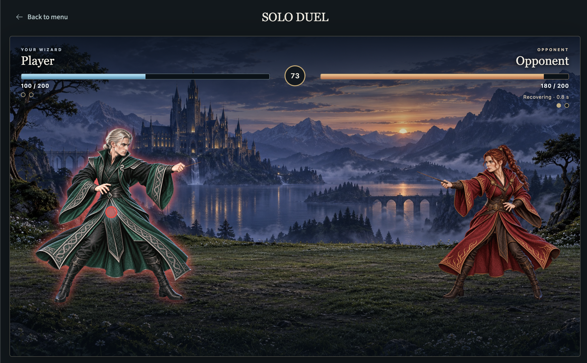

# Wizard Combat

Wizard Combat is a browser game that uses your webcam to recognize hand movements and turn them into magic spells. Draw a shape, then pause to cast.

Learn spells, practice on a dummy, or duel a computer opponent. Built for a short, playful break, the game can run locally or [on Spot](https://wizard-combat-game.spot.t1a.dev/) (T1A, NetBird sign-in). Online multiplayer is planned.

We do not store video or screenshots of players.



## The problem

Remote work can mean long hours at a desk, work stress, and few casual moments with colleagues. Across projects, weeks can pass without a chat. Research supports play as one way to address these problems.

- **Fun and a reset:** Wizard Combat aims to make a 5-10 minute desk break fun, e.g. while AI agents work. A [review of short breaks](https://journals.plos.org/plosone/article?id=10.1371/journal.pone.0272460) found less fatigue and more energy.
- **Stress relief:** A [review of games](https://mental.jmir.org/2021/8/e28150/) and a [cortisol study](https://www.sciencedirect.com/science/article/abs/pii/S0031938424002725) suggest gaming can ease stress.
- **Connection with colleagues:** Planned online duels give colleagues a reason to connect. A [study of virtual teams](https://discovery.ucl.ac.uk/id/eprint/10089877/) found that cooperative Spaceteam play improved trusting behavior compared with a social icebreaker. It did not test competitive duels.

Players use an ordinary webcam to draw spells, learn their movements, and fight a computer opponent. No VR headset or special controller is required.

## Built at Cyprus Odyssey

Wizard Combat is our project for the **T1A · Cyprus Odyssey · Fall 2026** hackathon. We are the **SHIP HAPPENS** team: **Sofia, Emil and Ivan**. Special thanks to Ricky the cat for his paws-on keyboard support, which earned him a spot in Credits.

Our category is **Everyday Odyssey. Tools for everyday life: learning, creativity, hobbies, or personal organization.** Inspired by the fantasy universes of **Harry Potter** and **Mortal Kombat**, we built Wizard Combat to let players cast spells with hand movements and fight magical duels.

The repository starts on October 15 at **15:23 UTC+1**, with the kickoff token `ODYSSEY-2026-UNLEASH-THE-GODS` in the first commit message: [`b5390ba`](https://github.com/sofia-404/wizard-combat/commit/b5390ba356e7b73aca1d6849c1600116a120d6a1).

The game uses third-party hand tracking, fonts, and audio. See the [licenses](licenses/) and [audio credits](licenses/audio/NOTICE.md) for those sources.

## Game features

From your first spell to a full duel, the current game includes:

- **Four spells drawn by hand.** Trace a circle for Protego, a V for Basic Cast, a Z for Confringo, or a corner for Expelliarmus. Draw with an extended finger or a wand grip. Pause at the end to cast.
- **Left- and right-handed play.** Choose your drawing hand in Options; all four spells work with either hand.
- **Your wizard, your setting.** Choose your character skin and stage. These choices change the look; every character uses the same combat rules.
- **Magic you can see and hear.** Spell trails, impacts, shields, character reactions, music, and sound effects show what happens during a fight. Music and effects have separate volume controls.
- **Three difficulty levels.** Easy gives you more time to draw and accepts less exact shapes. Hard asks for faster, more precise gestures and a quicker response to the opponent. Your input, difficulty, and audio settings stay saved in the browser.

| Mode | What you can do |
| --- | --- |
| **Spell Training** | Follow a path guide. Complete three casts of the selected spell, or block three incoming attacks for Protego. |
| **Practice Arena** | Test spells on a dummy that takes damage but does not attack. |
| **Solo Duel** | Fight a computer opponent that attacks and uses shields. Block with Protego and disarm it with Expelliarmus. |

These features are available now. Duels against other people are the next major goal.

## How to Run

You need a desktop or laptop with a camera and a browser.

### Open on Spot

Open [Wizard Combat on Spot](https://wizard-combat-game.spot.t1a.dev/) (T1A, NetBird sign-in). No local setup is needed. If you cannot access Spot, use the local option below.

Technical issues on Spot prevented us from setting up automatic deployment. For now, the team must manually upload the repository to Spot for each update.

### Run locally

You need [Node.js 24 or later](https://nodejs.org/) with npm. Check that both commands work and the Node.js version is 24 or later:

```sh
node --version
npm --version
```

Download and extract the repository ZIP, then open the extracted folder in a terminal. Or, if Git is installed, run:

```sh
git clone https://github.com/sofia-404/wizard-combat.git
cd wizard-combat
```

Start the local server:

```sh
npm start
```

No `npm install` or build step is needed to play. On the same computer, open the URL printed in the terminal, usually `http://127.0.0.1:5185/`. Use this address instead of opening `dist/index.html` directly. Keep the terminal open while you play. Press Ctrl+C there to stop the server.

If the camera does not start, allow camera access in your browser and retry. If the camera is busy, close other camera apps and retry.

## How it works

The browser turns camera frames into hand points, hand points into a drawn path, and a matched path into a spell. It also runs combat and the computer opponent. The Node.js server serves the game files and saves play records.

The diagram below shows a local run.

```text
+----------------------------------------------------------+
| BROWSER - HTML, CSS, JavaScript                          |
|                                                          |
| Camera frames                                            |
|   |                                                      |
|   v                                                      |
| +------------------------------------------------------+ |
| | Hand tracking worker                                 | |
| | Bundled MediaPipe model -> hand points + hand labels | |
| +------------------------------------------------------+ |
|   |                                                      |
|   v                                                      |
| +------------------------------------------------------+ |
| | Hand input and gesture checks                        | |
| | Select hand -> follow point -> hold, draw, pause     | |
| | Check path size, direction, and shape -> spell match | |
| +------------------------------------------------------+ |
|   |                                                      |
|   v                                                      |
| +------------------------------------------------------+ |
| | Active game mode + shared combat rules               | |
| | Training / Practice Arena / Solo Duel                | |
| | Release, queue, or reject -> shield or spell flight  | |
| | Hits, health, lesson progress, and round results     | |
| +------------------------------------------------------+ |
|   |                                                      |
|   v                                                      |
| +------------------------------------------------------+ |
| | Display and sound                                    | |
| | Path guides, fighters, effects, status, and audio    | |
| +------------------------------------------------------+ |
|                                                          |
| Record queue collects input and combat events.           |
+----------------------------------------------------------+
       ^                                  |
       | Files, model, and assets         | Events and path cards
       |                                  v
+----------------------------------------------------------+
| GAME SERVER - server.mjs                                |
| Serves dist/ | Saves logs and path cards in play-data/   |
+----------------------------------------------------------+
```

- **Track the hand, then read the gesture.** The [tracking worker](dist/tracker-worker.js) runs the bundled MediaPipe model. It returns hand points and left/right labels. [Hand input](dist/hand-input.js) selects the chosen hand; the game follows its index fingertip or the midpoint between two knuckles. [Gesture checks](dist/gesture.js) collect the path between holds and test it against the four spell shapes. If more than one shape matches, the cast is rejected. The model finds hands; the game's own code recognizes spells.

- **A match does not always release a spell.** [Shared fighter logic](dist/combat/solo-duel.js) checks recovery, disarm, and shield cooldown. It can release a spell, queue it, or reject it. Attack damage applies at impact, when the target's shield is checked. This keeps gesture recognition separate from combat timing.

- **Three modes share one set of rules.** The [spell registry](dist/spells/index.js) connects each spell to its gesture, guide, effects, and sound. [Combat rules](dist/combat/rules.js) hold damage, timing, and difficulty values. Each mode keeps its own state. Practice Arena and Solo Duel use the same [arena view](dist/arena-view.js) and [round logic](dist/combat/rounds.js); Training has its own [lesson progress](dist/spell-training/session.js). Solo Duel adds an opponent that chooses attacks and shield attempts in the browser.

- **Camera frames stay in the browser.** [The app](dist/app.js) starts capture only after the player selects Start camera and the browser grants access. It sends frames to the worker, one at a time. Tracking tries the GPU first and can fall back to the CPU. Camera images and video are not sent to the server. The record queue sends results, timing, tracking details, and drawn-path cards to the server that serves the game.

- **Saved settings and game progress are separate.** Input and audio options use browser storage. Character and stage choices use the URL. Health, rounds, and lessons stay in memory and reset on reload. In local runs, [server.mjs](server.mjs) writes event logs and path cards under `play-data/`; these records do not restore a match. The application source, model, artwork, and audio are in `dist/`, so playing needs no package install or build step.

## What comes next

**The main priority is online multiplayer:** duel another player over the internet.

Further planned work:

- Make spell damage and shield reliability depend on gesture accuracy. Current damage is fixed per spell; shield reliability does not yet depend on accuracy.
- Give shields a damage limit, so they can block only a limited amount of damage.
- Let players create custom spells.
- Offer character models with different stats that affect combat, beyond visual skins.
- Add a character scoreboard.
- Require players to say a spell aloud before drawing its gesture.
- Add fatalities: finishing moves at the end of a duel.
- Set up automatic deployment from the repository to Spot, so updates no longer require manual uploads.

These are planned features, not a release schedule.

## Camera and saved data

Camera input is processed in your browser with the bundled hand-tracking model. The game does not save camera images or video.

In local runs, the game saves results, timing, input settings, and tracking details under `play-data/`. Practice Arena and Solo Duel also save drawings of captured paths there.

Reloading resets game and lesson progress; saved records do not restore them.

## Cast your first spell

1. Open **Options**. Set **Drawing hand** to the hand you will use; the default is left.
2. Choose **Index fingertip** to draw with an extended finger. If you hold a wand, choose **Knuckles · wand grip**. The game tracks your hand, not the wand tip.
3. Return to the menu and open **Spell Training**. Choose a character or **Random**, then select **Choose location**. Pick a stage, or leave it random, then select **Start Game**. Choose a spell.
4. Select **Start camera** and allow camera access in your browser.
5. Keep your whole drawing hand visible. Hold still until **READY** appears.
6. Follow the path guide at normal speed. Make the shape at least one tenth of the camera view's width, then pause to cast.

```text
Hold -> READY -> Draw -> Pause -> Cast
```

If a spell does not cast, check your selected hand, keep it in view, and try a larger shape. **Easy** difficulty gives you more time and accepts less exact shapes.

Use **Stop camera** to stop camera input. **Back to menu** leaves the mode and stops the camera. In Spell Training, both actions clear active lesson counts. Completed lessons and learned marks remain until reload; restarting the camera starts a new attempt for the selected spell.

## Learn the spells

| Spell | Draw | Effect |
| --- | --- | --- |
| **Protego** | A circle, in either direction. | Block attacks with a shield for two seconds. |
| **Basic Cast** | A V: down, then up. | Damage the target. |
| **Confringo** | A Z: right, diagonally down-left, then right. | Damage the target. |
| **Expelliarmus** | Right, then down. Keep moving at the corner. | Damage the target and briefly disarm it. |

Follow the on-screen guides with either hand. For Protego training, finish your circle before the incoming spell hits.

Attack spells deal fixed damage: Basic Cast deals 20, Confringo deals 40, and Expelliarmus deals 10. Protego blocks all incoming damage while active. It has no damage limit yet.

## Rounds in Practice Arena and Solo Duel

Win two rounds to win the match. Each mode keeps a separate score; Practice Arena uses a passive dummy. Every round starts with 200 health per fighter. Zero health ends the round.

```text
Camera ready -> Round -> Fight -> Result
Result -> Next round, or match win after two round wins
```

Between rounds, temporary combat state clears; character, stage, settings, and score stay. The camera stays on. The 100-second timer runs only during active combat; zero time does not end the round.

Camera stop, tracker recovery, hidden pages, and navigation pause round flow and cancel pending actions. Resume when the camera is ready. Navigation keeps progress; reload clears it. Restart clears the match score. Training has separate lesson and reset rules.

See [round timing and reset details](docs/combat.md#rounds-in-practice-arena-and-solo-duel).

## Shared combat rules

All modes use the same player combat rules:

- **Recovery:** You can draw and queue a spell while waiting to cast again.
- **Protego:** Blocks attacks. A perfect block also interrupts the attacker.
- **Expelliarmus:** Deals damage and briefly stops the target from casting.

See the [combat reference](docs/combat.md#shared-combat-rules) for damage, timing, queues, and opponent behavior.

## Short build log

See [CHANGELOG.md](CHANGELOG.md) for the full commit history.

These milestones summarize the repository's commit history:

| Date | What was built |
| --- | --- |
| 2026-10-15 | Added camera gesture casting and four spells. Added a practice dummy, shared spell rules, training lessons, shields, and disarming. |
| 2026-10-15 | Added the main menu, saved options, music, spell sounds, and idle character motion. |
| 2026-10-16 | Added Solo Duel with opponent attacks and shields, difficulty-based combat timing, and expanded training health mechanics and event logs. |
| 2026-10-16 | Added separate audio volume controls and a looping menu animation. Updated camera processing and opponent rendering to reduce repeated work. |
| 2026-10-16 | Added character and stage selection, shared combat rules, and matches decided by two round wins. |

## Project details

- [Product scope](PRODUCT.md)
- [Spell implementation](docs/spells.md)
- [Design rules](DESIGN.md) and [screen specifications](docs/design/screen-specs.md)
- [Third-party licenses](licenses/) and [audio credits](licenses/audio/NOTICE.md)

For development, `npm test` runs the unit tests without package installation or a camera. Browser test commands are listed in [package.json](package.json); they need `npm ci` and `npx playwright-core install chromium`. Automated tests use simulated input.

Run `npm run test:rounds` for shared round flow, match results, pauses, and desktop/narrow previews with simulated input.
